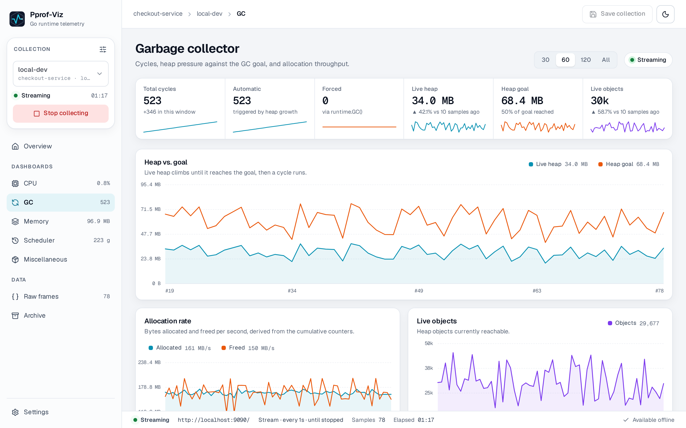
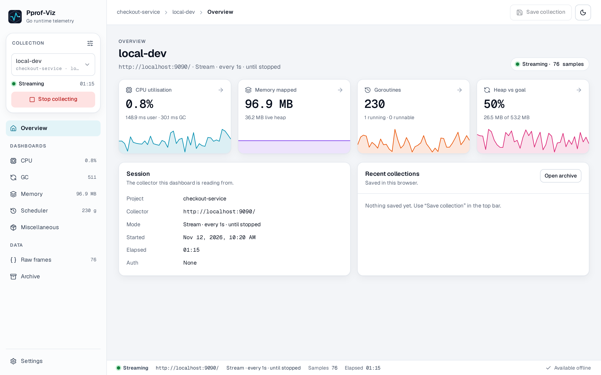
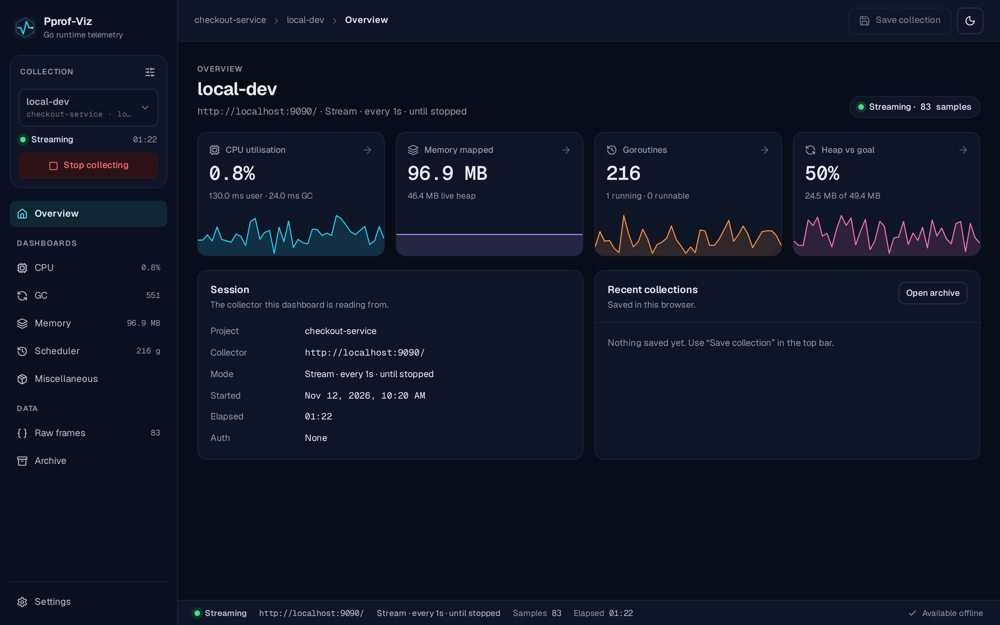
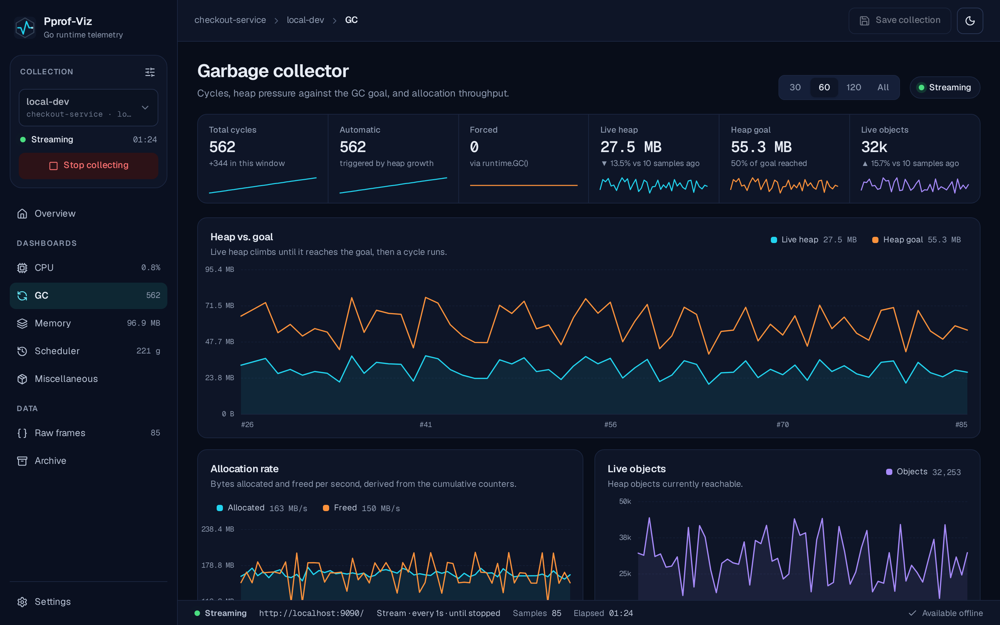
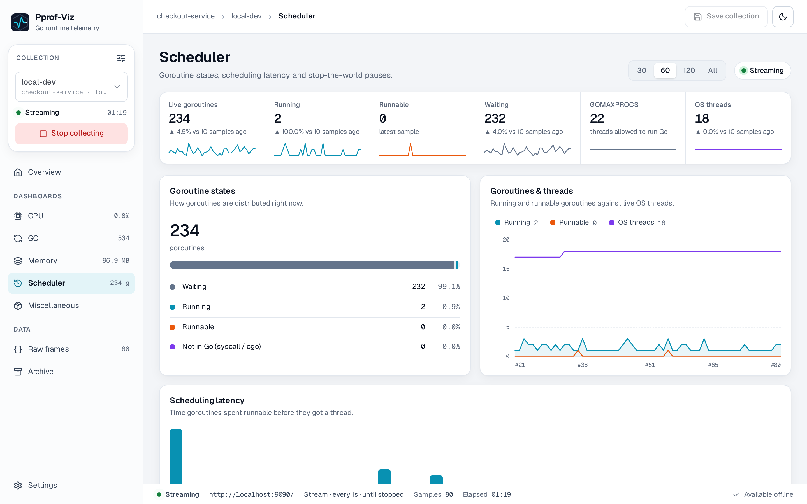
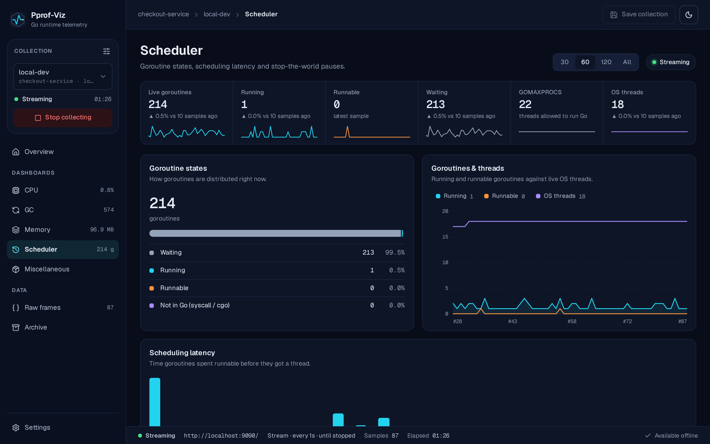

#  Pprof-Viz Web

[](https://www.gnu.org/licenses/gpl-3.0)

**A self-hostable, installable web dashboard for visualizing Go runtime telemetry in real time.**

<picture>
  <source media="(prefers-color-scheme: dark)" srcset="docs/screenshots/gc-dark.png">
  
</picture>

## 🔍 Overview

`Pprof-Viz Web` is a static Svelte 5 app that talks directly to the
`pprof-viz-collector` embedded in your Go service, and installs as a PWA so it keeps working
offline once it has been loaded.

Unlike standard `pprof`, which is designed for ad-hoc, deep-dive stack trace analysis,
`Pprof-Viz` is built for **continuous, high-resolution monitoring**: CPU usage, garbage
collection behavior, memory allocation and scheduler latencies, as they happen.

## ✨ Key Features

- **⚡️ Real-Time Telemetry**: Streams live Go runtime metrics over the Connect protocol.
- **📦 Zero Install**: Runs in the browser; installable to the home screen and usable offline.
- **🗄️ Local-Only Data**: Projects and profiles in IndexedDB, settings in `localStorage`, saved
  collections as compressed `.ppvz` files in the Origin Private File System. Nothing is
  uploaded anywhere.
- **📈 Dedicated Dashboards**: Route-based views for CPU, GC, Memory, Scheduler and more.
- **🐳 Self-Hosted**: Ships as a small Caddy container image you can run with Podman or Docker.

## 📸 Screenshots

Every page comes in a light and a dark theme; pick one in Settings or follow the system.

| Light | Dark |
| --- | --- |
|  |  |
|  |  |
|  |  |

## 🛠️ Getting Started

### 📋 Prerequisites

- [Bun](https://bun.sh/) (package manager)
- [Just](https://github.com/casey/just) (task runner)
- A running instance of [`pprof-viz-collector`](https://github.com/TB004/pprof-viz-collector)

### 📥 Development

```bash
bun install
just dev
```

Build the static site into `build/`:

```bash
just build
```

Preview the production build, including the service worker:

```bash
just preview
```

## 🐳 Self-Hosting

Every release publishes a multi-arch image and a `pprof-viz-web-<tag>.tar.gz` of the static
site. Pull the image:

```bash
podman run --rm -p 8080:80 ghcr.io/tb004/pprof-viz-web:latest
```

Or build it yourself:

```bash
just image          # podman build --format docker -t pprof-viz-web -f packaging/Containerfile .
just serve          # podman run --rm -p 8080:80 pprof-viz-web
```

The image is Caddy plus the static build; there is nothing to persist except Caddy's
certificate store. [`packaging/Caddyfile`](packaging/Caddyfile) reads three
environment variables:

| Variable            | Default | Purpose                                                       |
| ------------------- | ------- | ------------------------------------------------------------- |
| `SITE_ADDRESS`      | `:80`   | Caddy site address; set a hostname for automatic HTTPS.        |
| `SITE_ROOT`         | `/srv`  | Directory to serve.                                            |
| `COLLECTOR_ORIGINS` | `*`     | Origins the CSP allows the app to connect to.                  |

```bash
podman run --rm -p 443:443 -p 80:80 \
  -e SITE_ADDRESS=ppvz.example.com \
  -e COLLECTOR_ORIGINS="https://agent.internal:9090" \
  -v pprof-viz-caddy:/data \
  ghcr.io/tb004/pprof-viz-web:latest
```

> **Serve it over HTTPS.** Service workers, the Origin Private File System and persistent
> storage all require a secure context. `localhost` counts as one; a bare IP over plain HTTP
> does not, and the app will run without offline support or durable storage there.

### Collector requirements

The browser connects to the collector directly, so it is subject to browser rules:

- **CORS** — the collector must allow this app's origin, plus the `content-type`,
  `connect-protocol-version` and `authorization` request headers.
- **TLS** — certificates must be ones the browser already trusts. There is no per-profile
  "allow invalid certificates" escape hatch, because the page cannot override certificate
  validation.
- **Mixed content** — an HTTPS-hosted dashboard cannot reach an `http://` collector.

## 🏗️ Architecture

Everything runs in the browser; there is no server-side component beyond the static file host.

Code is grouped by feature: each folder holds its service (Svelte 5 runes), its logic and its
components. Components used by a single page sit next to that page in `src/routes`.

| Concern                | Implementation                                                               |
| ---------------------- | ---------------------------------------------------------------------------- |
| Collection session     | `src/lib/session` — Connect over `fetch`, run in a dedicated Web Worker       |
| Wire schema            | `proto/collector.proto` — shared with the desktop app, `just proto`           |
| Projects & profiles    | `src/lib/profiles` — IndexedDB (`src/lib/db.ts`)                              |
| Saved collections      | `src/lib/archive` — delta-encoded, zstd `.ppvz` in OPFS (`src/lib/files.ts`)  |
| Import & export        | `src/lib/transfer` — `.ppvzb` bundles, optionally with encrypted tokens       |
| Settings               | `src/lib/settings.svelte.ts` — `localStorage`                                 |
| Service wiring         | `src/lib/app.svelte.ts` — the one instance of each service                    |
| Offline & updates      | `src/service-worker.ts`, driven by `src/lib/updates.svelte.ts`                |

## 🤖 AI Notice

This project is developed with heavy use of AI coding assistants. Large parts of the code,
the commit messages and the pull requests were written with AI tools, then reviewed and
directed by the maintainer. Keep that in mind when you read or reuse the code, and please
report anything that looks wrong.

## 📄 License

This project is licensed under the GNU General Public License v3.0 - see the [LICENSE](LICENSE)
file for details.
